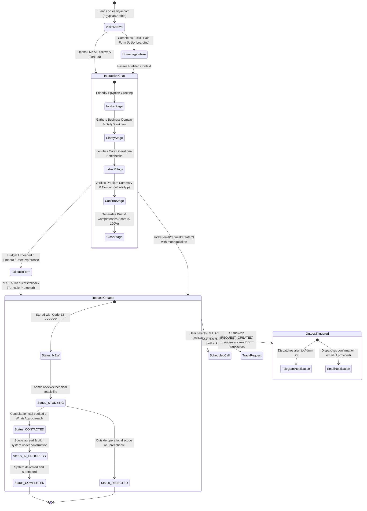
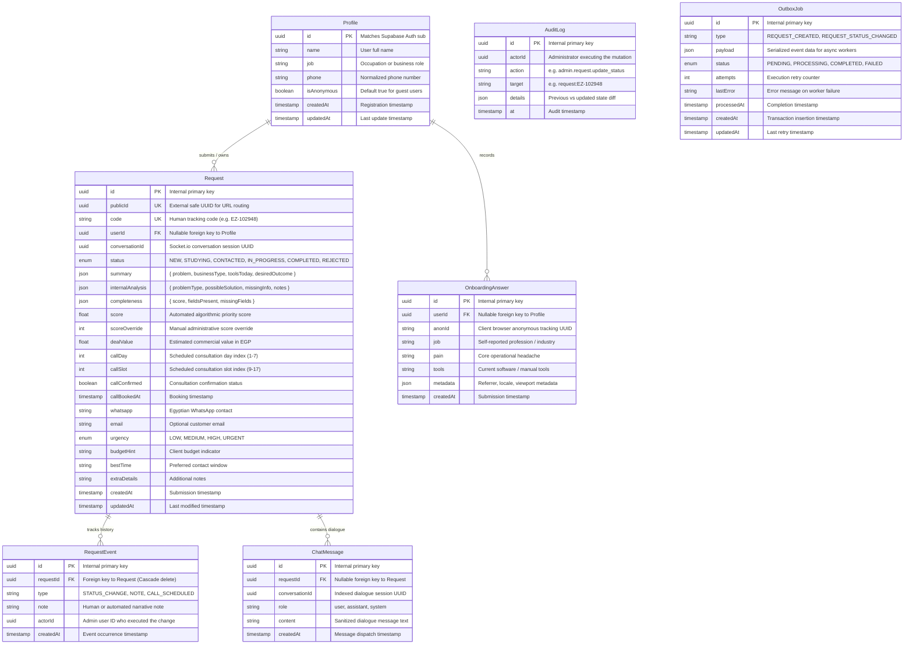

# EazifyAi — System Architecture & Technical Specifications

This document defines the high-level architecture, component topology, state machines, data models, security frameworks, and scalability mechanisms powering the EazifyAi platform.

---

## 1. High-Level System Architecture & Component Topology

EazifyAi separates concerns into two cohesive layers: an SSR-optimized Next.js 16 frontend and an Express 5 real-time backend, backed by PostgreSQL, Supabase Auth, Redis, and Google Gemini AI.

```mermaid
flowchart TB
    subgraph ClientLayer ["1. Client & Edge Layer"]
        User["Egyptian Business Owner / Client"]
        AdminUser["EazifyAi Operations Admin"]
        Cloudflare["Cloudflare Edge Network\n- Full Strict TLS\n- Turnstile Bot Verification\n- DDoS & WAF\n- WebSocket Proxy"]
    end

    subgraph WebLayer ["2. Frontend Web Application (eazifyai-web)"]
        NextApp["Next.js 16 App Router\n- React 19 & Turbopack\n- next-intl (Egyptian Arabic & English)\n- Server Actions\n- Token-based CSS System"]
        SupaSSR["@supabase/ssr\n- Secure Cookie Storage\n- Session Refresh"]
    end

    subgraph BackendLayer ["3. Backend API Service (eazifyai-api)"]
        ExpressApp["Express 5 REST API\n- Request ID Tracing (UUIDv4)\n- Asymmetric JWKS JWT Verification\n- Rate Limiters (Public, Auth, Admin)\n- Helmet & Input Sanitization"]
        SocketServer["Socket.io 4.8 Streaming Engine\n- Bi-directional Token Streaming\n- Turn Concurrency Mutex (TurnRegistry)\n- Handshake Bot & Session Gate"]
        LangGraphAgent["Gemini AI Discovery Agent\n- LangGraph State Machine\n- Egyptian Dialect Calibration\n- Egyptian National ID / PII Redaction\n- AI Daily Budget Circuit Breaker"]
        OutboxDispatcher["Transactional Outbox Worker\n- PENDING Job Dispatcher\n- Exponential Backoff Retries"]
        BossQueue["pg-boss Queue Engine\n- PostgreSQL Backed Queues\n- Transactional Advisory Locks"]
    end

    subgraph DataLayer ["4. Persistence & External Services"]
        PG[(PostgreSQL Database)\n- Supabase Managed / Port 5432 & 6543\n- Prisma 7 ORM Engine\n- Row Level Security (RLS)]
        RedisStore[(Redis Cluster)\n- @socket.io/redis-adapter\n- Multi-Instance Room Synchronization]
        GeminiAPI["Google Gemini 2.0 Flash / Flash Lite\n- Generative AI Studio"]
        TelegramAPI["Telegram Bot API\n- Webhook & Long-polling Fallback\n- Admin Chat Alerts & Interactive Bot"]
        EmailService["Transactional Email\n- Resend API / SMTP"]
    end

    User -->|HTTPS & WSS| Cloudflare
    AdminUser -->|HTTPS| Cloudflare
    Cloudflare -->|Route: /| NextApp
    Cloudflare -->|Route: api.| ExpressApp
    Cloudflare -->|Route: /socket.io| SocketServer

    NextApp -->|Cookie Auth| SupaSSR
    NextApp -->|Server Actions & REST| ExpressApp
    NextApp -->|Real-time Discovery| SocketServer

    ExpressApp -->|Prisma Pooler| PG
    SocketServer -->|Adapter Sync| RedisStore
    SocketServer -->|Turns & Dialogue| LangGraphAgent
    LangGraphAgent -->|LLM Inference| GeminiAPI
    LangGraphAgent -->|Record Outbox| OutboxDispatcher

    ExpressApp -->|Transactional Writes| PG
    OutboxDispatcher -->|Read PENDING Jobs| PG
    OutboxDispatcher -->|Enqueue Jobs| BossQueue
    BossQueue -->|Telegram Alerts| TelegramAPI
    BossQueue -->|Status Emails| EmailService
    TelegramAPI -->|POST /v1/webhooks/telegram| ExpressApp
```

---

## 2. End-to-End User Journey State Machine

The core value of EazifyAi is removing friction from the software procurement process for non-technical Egyptian clients. The following state machine illustrates the complete lifecycle from anonymous discovery to completed software delivery:



---

## 3. Data Model & Entity Relationship (ER) Diagram

The persistence layer is modeled with strict relational integrity, indexed foreign keys, and audit logging.



---

## 4. Security Architecture

Security is baked into every architectural boundary through defense-in-depth principles:

### 4.1 Cloudflare Turnstile Bot Protection
- **Edge Challenge**: Applied to both HTTP fallback lead capture (`POST /v1/requests/fallback`) and Socket.io handshake authentication.
- **Verification Service**: Handled by `TurnstileService` against Cloudflare's `siteverify` endpoint with remote IP correlation (`CF-Connecting-IP`).
- **Safe Development Bypass**: If `TURNSTILE_SECRET_KEY` is omitted in development, tests and local developers can proceed without blocking.

### 4.2 AI Budget Circuit Breaker (`AiBudgetService`)
- **Spend Guardrail**: An in-memory circuit breaker monitors token consumption for all Gemini LLM invocations.
- **Automatic Rollover**: Automatically resets spend counters at 00:00 UTC daily.
- **Fail-Safe Fallback**: If the aggregate cost exceeds `env.AI_DAILY_BUDGET_USD` (default `$5.00/day`), the circuit breaker trips immediately. Subsequent chat messages emit `agent:fallback` with `reason: 'budget_exceeded'`, guiding the client to the manual lead form without crashing the server.

### 4.3 Asymmetric JWKS Authentication & MFA (AAL2)
- **Zero-Secret Verification**: The backend validates Supabase JWTs locally using remote public keys fetched from `${SUPABASE_URL}/auth/v1/.well-known/jwks.json`. No shared JWT secret is exposed between services.
- **Admin Role Isolation**: Administrative access strictly requires `app_metadata.role === 'admin'`. Roles in `user_metadata` are rejected to prevent client-side privilege escalation.
- **AAL2 Multi-Factor Enforcement**: When `ENFORCE_AAL2=true`, all `/v1/admin/*` mutations verify that the administrator's JWT contains Authenticator Assurance Level 2 (`aal === 'aal2'`).

### 4.4 Defense-in-Depth Rate Limiting & Input Sanitization
- **Tiered Limiters**: Strict rate limiting by IP and user ID across all endpoints (Public: 60/min, Auth writes: 15/15min, Fallback: 3/min, Socket: 20 msg/min, Admin: 120/min).
- **Reverse Proxy Header Trust**: Enabled via `TRUST_PROXY=1`, reliably extracting client IPs from `CF-Connecting-IP`.
- **Sanitization & Masking**: All user chat strings are stripped of HTML/script injection tags. Unauthenticated requests to `/v1/requests/:publicId` receive masked Egyptian phone numbers (`010****5678`) and emails (`d***@gmail.com`).

### 4.5 Timing-Safe Cryptographic Operations
- **Telegram Webhook Secret**: `POST /v1/webhooks/telegram` compares the inbound `X-Telegram-Bot-Api-Secret-Token` header using `crypto.timingSafeEqual` against `TELEGRAM_WEBHOOK_SECRET`.
- **Capability Tokens (`manageToken`)**: Anonymous request management tokens are verified in constant time (`crypto.timingSafeEqual`), eliminating side-channel timing attacks.

---

## 5. Scalability Architecture

EazifyAi is designed for reliable horizontal scaling across containerized cloud environments:

### 5.1 Transactional Database Outbox Pattern
Directly emitting network requests (emails, Telegram notifications) inside an API request lifecycle creates two failure risks:
1. **Network Latency**: Delays response time to the user.
2. **Dual-Write Vulnerability**: If the database transaction commits but the network call fails, notifications are lost forever; conversely, if the network call succeeds but the database rolls back, phantom alerts are sent.

**Solution**:
- All events (`REQUEST_CREATED`, `REQUEST_STATUS_CHANGED`) are written as `OutboxJob` rows inside the **exact same database transaction** as the entity mutation.
- A background worker polls or listens for `PENDING` outbox entries and safely dispatches them to `pg-boss`.
- Jobs feature exponential backoff retry counters and permanent audit logging.

### 5.2 Telegram Webhook vs Long-Polling Mode
- **Development**: When running locally without a public domain, `eazifyai-api` automatically starts a long-polling listener (`getUpdates`) to receive interactive admin commands.
- **Production Multi-Instance**: When running multiple container replicas behind a load balancer, concurrent long-polling produces Telegram `409 Conflict` errors. Setting `TELEGRAM_WEBHOOK_URL` automatically disables long-polling across all replicas and routes updates to `POST /v1/webhooks/telegram`.

### 5.3 Multi-Instance WebSocket Clustering (Redis Adapter)
- **Sticky Sessions / Clustering**: Socket.io instances bind to a shared Redis Pub/Sub cluster via `@socket.io/redis-adapter`.
- **Broadcast Synchronization**: Allows an admin on node A to broadcast an order update to a client connected to node B.
- **Resilience**: Redis client connections include automated reconnection strategies with retry backoffs and graceful shutdown cleanup.
